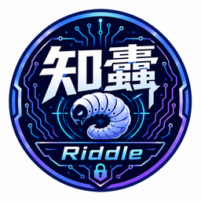
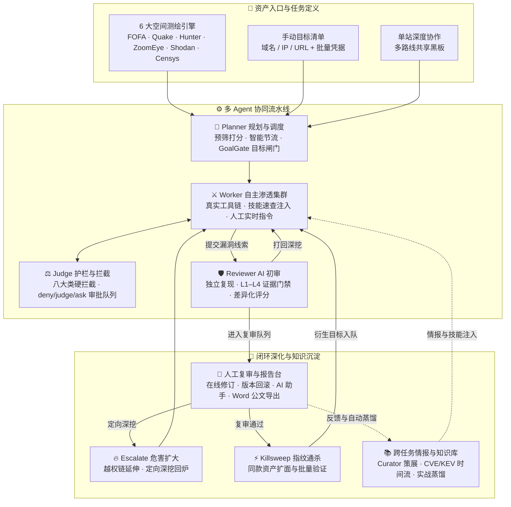

<div align="center">

<p align="center">
  
</p>

# 知蠹 Riddle

**AI 自主安全渗透与漏洞挖掘平台 · 六角色多 Agent 协同 · 融合治理护栏 · AI 初审 + 人工复审闭环**

[](LICENSE)


</div>

---

## 项目定位

传统自动化扫描器面临两大痛点：**海量低价值误报**（仅依赖特征匹配，人工排查成本高）与**业务逻辑盲区**（无法理解认证流程、状态机、权限边界与多步利用链）。

**知蠹 Riddle** 将大语言模型与真实安全工具链结合，构建了一套面向授权安全测试与 SRC 场景的**自主探索—实证验证—智能治理—报告交付**闭环平台：

- **自主决策与真实取证**：Worker Agent 自动完成页面/JS/API 侦察、构造业务测试向量并驱动真实工具发包验证，拒绝「纸面猜洞」。
- **AI 极理性初审 + 融合门禁**：内置 Reviewer 独立复现与 L1–L4 机械凭据评估，自动拦截误报、重复线索与半成品，并可附带定向指令自动打回深挖。
- **人机协同与持续进化**：安全研究员只需聚焦最终复审裁决、运行中实时下发人工指令与定向深挖；过审漏洞自动触发指纹通杀扩面、情报反馈与高危知识蒸馏，让平台越挖越准。

---

## 核心工作流与六角色协同架构



---

## 核心能力一览

### 1. 自主挖掘与质量保障
| 能力 | 说明 |
|---|---|
| **EduSRC / 企业 SRC 双模式** | 适配高校 IP/归属离线反查、教育网通杀优先与企业授权边界管控，支持独立评分与交付规范 |
| **六大空间测绘引擎** | 原生接入 FOFA、Quake、Hunter、ZoomEye、Shodan、Censys，支持查询语法实时校验、模板填充与连通探活 |
| **单站多路线协作** | 面向单站深挖自动拆分侦察盘点、认证越权、未授权/配置暴露、文件/上传、注入/RCE、业务逻辑等路线，通过共享黑板互通线索、自动错峰 |
| **真实工具链 + 持久化终端** | 容器内置 `nmap`、`httpx`、`nuclei`、`sqlmap`、`whatweb` 及 20+ 专项安全工具；支持工作目录与环境持久化的受控终端执行 |
| **硬骨头回捞与通杀闭环** | 跨任务聚合死磕失败（`dead`）与跳过（`skipped`）目标，支持一键唤醒回捞并注入最新沉淀情报；过审漏洞自动触发指纹通杀扩面 |
| **登录态与凭据批量绑定** | 支持按 URL / 通配符批量粘贴 `Cookie`、`Authorization: Bearer`、`username:password`，实时解析并注入测试上下文 |

### 2. 融合治理与交付层
| 模块 | 说明 |
|---|---|
| **目标闸门（GoalGate）** | 按任务场景智能拆解可核验验收标准，诚实评估任务终态（`achieved` / `incomplete`） |
| **证据硬闸门（L1–L4）** | 按机械凭据对漏洞证据做 L1–L4 分级与试算，支持强拦截开关与提示词纪律双模式 |
| **范围硬守卫（ScopeGuard）** | 按 `own / source / foreign` 对资产写回做越界分类，支持授权根域与 CIDR 校验 |
| **命令三层拦截与审批** | 结合任务级八大高危操作硬拦截（脱库、删数据、篡改、清缓存、改密、爆破、DoS、落马）与 `deny / judge / ask` 人工审批台账 |
| **多角色分层模型路由** | 支持单端点多模型灾备池与多供应商加权熔断池，并可为 `Planner / Worker / Reviewer / Judge` 独立覆写模型 |
| **情报与 CVE/KEV 时间流** | 跨任务共享凭证/指纹/端点/经验情报（带效用打分与 Intel Curator 清理），同步 NVD & CISA KEV 并支持语义版本区间反查 |
| **实证流量与双图溯源** | 自动导入工作区 HTTP JSONL 流量，按 `baseline / proof / verification / supporting` 绑定漏洞证据链；旁路构建资产图 × 探索图与覆盖度 |
| **复测闭环与公文级 Word 报告** | 支持报告正文在线编辑（`user_edits`）、审计版本历史一键回滚、AI 报告润色助手、HTTP 只读探活/手工复测登记，一键导出公文级 `.docx`、Markdown、HTML、JSON 与整任务报告包 |

### 3. 全新现代化控制台（Next.js 16 + Shadcn UI）
控制台采用三分组 13 个核心模块设计，兼顾明暗主题与响应式布局：

- **作战中心**：`作战总览` · `挖掘任务`（含三段式新建/编辑任务向导与实时作战大屏、在跑 Worker 人工实时指令、单目标轨迹回放）· `漏洞与复审`（抽屉快审 + 完整报告编辑与 AI 助手页）· `目标与硬骨头`（硬骨头一键回捞联动启动 + 通杀候选）· `实证流量库` · `执行回放`
- **知识与治理**：`情报与 CVE`（实战情报策展 + CVE 时间流 + 语义版本反查）· `技能与知识库`（蒸馏知识 CRUD + 技能速查卡）· `融合护栏与审批`（三大硬闸门热开关 + 命令/证据/范围试算台）
- **系统与模型**：`模型与多角色路由` · `Agent 协同` · `运行日志`（全局异常诊断 + SSE 实时流）· `系统与引擎配置`（六大测绘引擎 + 融合九开关 + 工作目录清理 + SQLite 快照备份恢复 + 三权分立令牌）

---

## 快速开始

### 方式一：Docker Compose 一键部署（推荐）

准备一台安装 Docker 的 Linux / macOS / Windows 主机（建议 2C4G 起，磁盘 ≥ 20 GB）：

```bash
git clone https://github.com/moliyu1101/riddle.git
cd riddle
cp .env.example .env
# 编辑 .env，至少填写 LLM_API_KEY；公网部署务必设置 RIDDLE_API_TOKEN
docker compose up -d --build
docker compose logs -f riddle
```

首次构建将编译 Next.js 静态前端并安装安全工具链，就绪后浏览器访问 `http://<服务器IP>:18800/`。

### 方式二：本地源码运行（前后端开发调试）

环境要求：**Python 3.12+**、**Node.js 20+**。

```bash
# 1. 安装后端依赖
pip install -r requirements.txt

# 2. 构建前端静态产物并同步至 web/dist/
npm --prefix frontend ci
npm --prefix frontend run build

# 3. 配置环境变量并启动后端（同时托管 API 与前端页面）
cp .env.example .env
python -m uvicorn app.main:app --host 127.0.0.1 --port 18800
```

如需单独进行前端热更新开发，可在保持后端运行在 `18800` 端口的同时执行：

```bash
npm --prefix frontend run dev
```

---

## 关键配置说明

最少只需配置一个 **LLM API Key** 即可启动；所有密钥也可直接在控制台「系统与引擎配置 / 模型与多角色路由」中可视化配置（数据库配置优先级高于 `.env`，写入即热生效）。

| 环境变量 | 说明 |
|---|---|
| `LLM_API_KEY` | **必填**，大模型 API Key（兼容 OpenAI / Anthropic 协议，支持 DeepSeek、Claude、GPT、Kimi、通义等） |
| `LLM_BASE_URL` / `LLM_MODEL` / `LLM_PROTOCOL` | 模型端点与协议（默认 `deepseek-chat`，协议支持 `auto` / `openai_chat` / `anthropic_messages`） |
| `FOFA_KEY` / `QUAKE_KEY` / `HUNTER_KEY` / `ZOOMEYE_KEY` / `SHODAN_KEY` / `CENSYS_KEY` | 可选，对应六大空间测绘引擎 API Key |
| `RIDDLE_API_TOKEN` | 全权限访问令牌，**公网部署务必配置** |
| `RIDDLE_READ_TOKEN` / `RIDDLE_OBSERVER_TOKEN` | 可选，分别对应只读审核角色与脱敏观摩角色令牌 |
| `RIDDLE_HOST_PORT` | Docker 映射宿主机端口，默认 `18800` |
| `RIDDLE_RESTORE_ON_STARTUP` | 设为 `1` 时，服务重启后自动续跑未完成的运行中任务 |

> **登录与三权分立说明**
> - 未配置任何令牌时，本地可直接免密进入控制台（默认全权限）。
> - 配置 `RIDDLE_API_TOKEN` 或在控制台设置页启用令牌后，访问将自动跳转登录页，按输入令牌赋予 `full`（全权限）、`readonly`（只读）或 `observer`（脱敏观摩）权限。

---

## 运维、备份与安全防护

```bash
docker compose up -d --build    # 拉取更新后重新构建部署
docker compose restart riddle   # 重启服务
docker compose down             # 停止服务（数据保留在命名卷中）
docker compose logs -f riddle   # 查看实时运行日志
```

- **数据持久化与备份恢复**：Docker 卷 `riddle_data` 存储 SQLite 数据库与取证文件，`riddle_work` 存储 Worker 工作区。由于 SQLite 使用 WAL 模式，请勿直接拷贝 `.db` 文件，统一在控制台「系统与引擎配置 → 工作目录与备份恢复」中创建热快照或导出 `.tar.gz` 归档。
- **内建安全边界**：容器以非 root 用户运行，内置 SSRF 出网守卫（封禁内网与云元数据地址）、可调阈值 WAF 中间件与任务级高危操作硬拦截。

---

## 技术栈

- **后端**：Python 3.12 · FastAPI · SQLAlchemy (Async) · Alembic · SQLite (WAL) · python-docx
- **前端**：Next.js 16 (Static Export) · React 19 · TypeScript · Tailwind CSS 4 · Shadcn UI · Lucide Icons
- **模型与测绘**：OpenAI / Anthropic 双协议兼容（含 `RIDDLE_TOOL_COMPAT=prompt` 兜底与多端点熔断池）· 6 大空间测绘引擎 · 内置 `nmap / httpx / nuclei / sqlmap / whatweb`

---

## 免责声明与许可协议

**使用知蠹 Riddle 前，请完整阅读并同意以下条款：**

1. **严格限定授权范围**：本平台仅面向获得明确书面授权的渗透测试、安全评估、SRC 众测及学术研究场景。严禁对任何未授权目标实施扫描或测试，因违规使用产生的一切法律责任由使用者自行承担。
2. **技术与自动化风险**：大模型驱动的自主工具调用具有一定不确定性。尽管系统内置了高危操作硬拦截、范围守卫与 SSRF 防护，仍无法对极端场景提供 100% 绝对担保，请务必在充分评估测试边界后使用。
3. **开源许可**：本项目基于 **CC BY-NC 4.0** 协议发布，仅限学习研究与非商业用途，禁止任何商业化封装或恶意滥用。

---

<div align="center">

**Powered By moliyu1101** · 知蠹 Riddle

*仅供授权安全测试与研究 · 请遵守当地法律法规*

</div>
